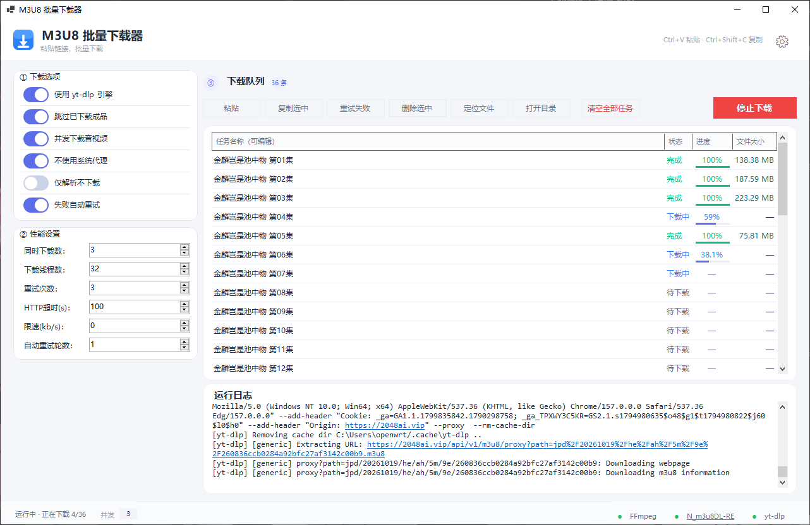
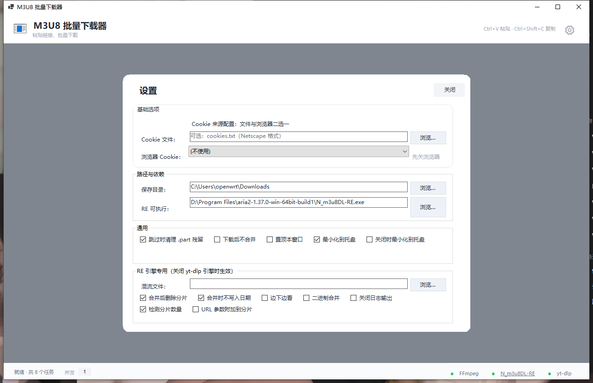
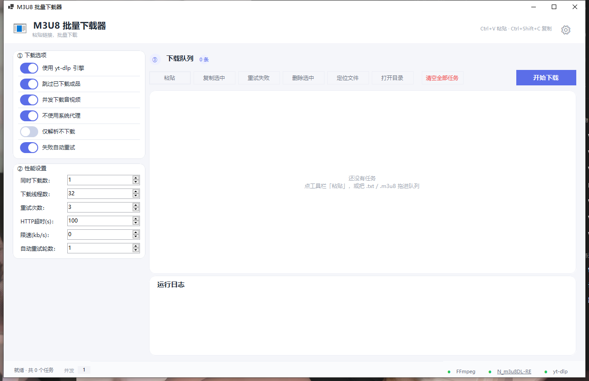

# M3U8DL-GUI-HUANGDOU

[](LICENSE)

基于 **.NET 10 + WinForms** 的 HLS 批量下载器图形界面，封装 [`N_m3u8DL-RE`](https://github.com/nilaoda/N_m3u8DL-RE) 与 [`yt-dlp`](https://github.com/yt-dlp/yt-dlp) 两个下载引擎，把命令行工具的常用能力收进一个卡片式桌面程序里。



## 特性

**双引擎，可切换，可自动降级**

- 默认走 `N_m3u8DL-RE`（HLS 专用，分片并发与合并能力更强）
- 可切到 `yt-dlp`（站点适配面更广，支持 `--cookies-from-browser`）
- yt-dlp 遇到 Cookie / DRM 类失败时自动降级到 RE 重试，并在日志里说明原因

**任务队列**
- 本程序是自用来下载互联网AI短剧（你懂的），只支持脚本以 `name|url|referer|ua|cookie|origin|x-cdn-auth` 八段扩展格式
- 粘贴链接批量入队，一行一条
- 下载中可继续增删任务；停止时可中断单个任务（按任务 ID 定位进程，不受表格行漂移影响）
- 右键菜单：打开所在文件夹、重命名、复制链接、复制任务、重试选中/失败任务、清空
- 失败自动重试，可配置轮数与并发数；支持跳过已下载成品、清理 `.part` 残留

**界面**

- PerMonitorV2 高 DPI，圆角卡片、开关、分组徽标全部自绘，无第三方 UI 库
- 下载选项 / 性能设置 / RE 引擎专用参数分区排布
- 最小化或关闭到系统托盘，下载继续在后台跑
- 本次运行日志面板 + 底部状态栏（引擎路径可点击直达）

**配置持久化**

- 任务队列与全部选项自动保存，重启即恢复
- 设置页分组管理：路径与依赖 / 性能 / 合并 / 命名 / 网络

| 设置页 | 空态 |
|---|---|
|  |  |

## 环境要求

| 依赖 | 版本 | 说明 |
|---|---|---|
| .NET SDK | 10.0+ | 目标框架 `net10.0-windows`，仅 Windows |
| N_m3u8DL-RE | 2024+ | 必需。程序会在 PATH 与注册表 PATH 中查找，也可在设置页手动指定 |
| yt-dlp | 任意近期版本 | 可选，仅在选用 yt-dlp 引擎时需要 |
| FFmpeg | 任意近期版本 | 可选，需要合并音视频轨或转封装时需要 |

> 仓库**不包含**任何第三方二进制。请自行下载 `N_m3u8DL-RE.exe`、`yt-dlp.exe`、`ffmpeg.exe` 放进 PATH 或程序目录。

## 构建与运行

```bash
# 构建全部四个项目
dotnet build M3U8DL.sln -c Release

# 直接运行
dotnet run --project M3U8DL

# 发布单文件（自包含 + 压缩，约 49 MB）
dotnet publish M3U8DL/M3U8DL.csproj -c Release -r win-x64 --self-contained true \
  -p:PublishSingleFile=true -p:IncludeNativeLibrariesForSelfExtract=true \
  -p:EnableCompressionInSingleFile=true -o publish
```

## 测试

测试用自建的轻量断言框架（不依赖 xUnit），编译成控制台程序直接跑，覆盖引擎命令构造、任务解析、队列状态机、持久化与 UI 交互，共 **367 条断言**：

```bash
# FakeDownloader 是一个按 FAKE_MODE 环境变量模拟各种下载结局的假引擎
dotnet publish Fake/Fake.csproj -c Release -r win-x64 --self-contained true \
  -p:PublishSingleFile=true -o Fake/publish

cd M3U8DL.Tests
dotnet build
FAKE_EXE="../Fake/publish/FakeDownloader.exe" ./bin/Debug/net10.0-windows/M3U8DL.Tests.exe
```

## 目录结构

| 路径 | 说明 |
|---|---|
| `M3U8DL/` | 主程序。`MainForm.*` 为按职责拆分的分部类（UI 布局 / 队列 / 下载 / 持久化 / 设置） |
| `M3U8DL/Core.cs` | 任务模型、行格式解析（`TaskLines`）、PATH 探测（`PathProbe`）、输出文件识别 |
| `M3U8DL/Engine.cs` | 两个引擎的命令构造与进程管理、输出解析、失败分类与降级判断 |
| `M3U8DL/Controls/` | 自绘控件：圆角卡片、阴影宿主、开关、徽标、带进度条的表格 |
| `M3U8DL.Tests/` | 回归测试（含反射式访问私有成员的契约测试） |
| `Fake/` | 假下载引擎，供测试注入各种失败场景 |
| `_screenshot/` | 无人值守截图工具，`--shot` 模式下渲染各界面并落盘 |
| `docs/` | 架构审查与重构设计记录 |

## 下载加速

程序默认下发的参数（可在设置页调整）：

| 引擎 | 参数 | 作用 |
|---|---|---|
| RE | `--auto-select true` | 多轨道片源自动选最高码率，且避免弹交互选择框导致 GUI 卡死 |
| RE | `--thread-count` | 分片下载线程数，默认 32 |
| RE | `--concurrent-download` | 音视频多轨并行下载 |
| RE | `--tmp-dir <保存目录>/.nm3u8dl-tmp` | 临时目录与成品同盘，合并后退化为 rename，省一次全量复制 |
| RE | `--use-ffmpeg-concat-demuxer` | 合并改用 concat 分离器，数千分片时不再撞命令行长度上限 |
| RE | `--disable-update-check true` | 免每次启动联网查版本 |
| yt-dlp | `--concurrent-fragments` | 分片并发，与线程数同步（不再受"并发下载音视频"开关影响） |
| yt-dlp | `--http-chunk-size 10M` | 单连接型 CDN 上按块并行拉取，提升直链吞吐 |

合并方式为严格三选一：`跳过合并` > `二进制合并` > `concat 分离器`，不会同时下发。

## 配置文件

| 文件 | 位置 | 内容 |
|---|---|---|
| `settings.json` | `%APPDATA%\NM3U8DL_GUI\` | 引擎路径、全部下载选项、界面偏好 |
| `tasks.json` | `%APPDATA%\NM3U8DL_GUI\` | 任务队列（不含运行期 ID） |

## 许可证

[MIT](LICENSE) © 2026 lunseils

即你可以自由使用、修改、分发、商用本项目代码，只需保留版权声明与许可声明。

调用的第三方工具各自遵循其原始许可：`N_m3u8DL-RE`（MIT）、`yt-dlp`（Unlicense）、`FFmpeg`（LGPL/GPL，取决于构建配置）。使用时请遵守目标站点的服务条款与当地法律法规。
